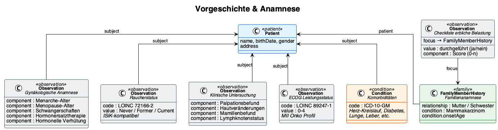

# Medical History & Anamnesis - Kerndatensatz Senologie v0.10.0

* [**Table of Contents**](toc.md)
* [**Data Model**](datenmodell.md)
* **Medical History & Anamnesis**

## Medical History & Anamnesis

 This page includes translations from the original source language in which the guide was authored. Information on these translations and instructions on how to provide feedback on the translations can be found [here](translationinfo.html). 

Content to follow.

### Related Resources

| | |
| :--- | :--- |
| Profile | [Senologie_Gynaekologische_Anamnese](StructureDefinition-senologie-gynaekologische-anamnese.md) |
| Profile | [Senologie_Familienanamnese](StructureDefinition-senologie-familienanamnese.md) |
| Profile | [Senologie_Klinische_Untersuchung](StructureDefinition-senologie-klinische-untersuchung.md) |
| Profile | [Senologie_Checkliste_Erbliche_Belastung](StructureDefinition-senologie-checkliste-erbliche-belastung.md) |
| Questionnaire | [Initial History (Erstanamnese)](Questionnaire-senologie-erstanamnese.md) |
| Questionnaire | [Clinical Examination (Klinische Untersuchung)](Questionnaire-senologie-klinische-untersuchung.md) |
| Example | [Case 1 — Gynaecological History (Gynäkologische Anamnese)](Observation-Fall1-Gynaekologische-Anamnese.md) |
| Example | [Case 1 — Family History (Familienanamnese)](FamilyMemberHistory-Fall1-Familienanamnese.md) |
| Example | [Case 1 — Clinical Examination (Klinische Untersuchung)](Observation-Fall1-Klinische-Untersuchung.md) |

