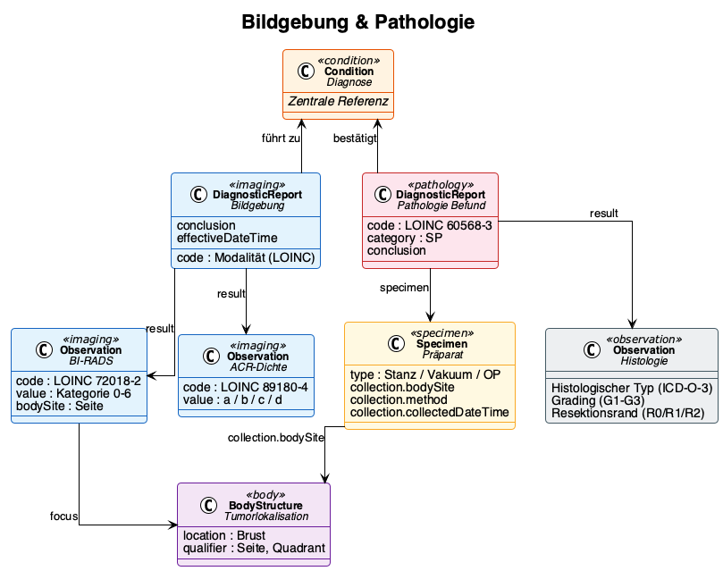

# Imaging & Pathology - Kerndatensatz Senologie v0.10.0

* [**Table of Contents**](toc.md)
* [**Data Model**](datenmodell.md)
* **Imaging & Pathology**

## Imaging & Pathology

### Structured Reports in Breast Cancer Care

Imaging and pathology provide the diagnostic foundation for staging and treatment decisions. Although both disciplines work with well-established classification systems (BI-RADS, TNM, Allred score), their results originate from specialised subsystems that have rarely delivered findings in a uniformly structured, machine-readable format. Looking ahead, technical standards such as the HL7 Europe Imaging Study Report or the MII Pathology specification can serve as a bridge — provided that the relevant professional societies endorse the required content definitions and terminologies.

Until then, clinical documentation takes on the role of structuring: clinicians select standardised categories, capture defined data points, and thereby enable the transformation into an interoperable data model.

### Imaging

#### Modalities and Coding

| | | | |
| :--- | :--- | :--- | :--- |
| Bilateral mammography | Screening, work-up | 24606-6 | 71651007 |
| Bilateral ultrasound | Supplementary, interventional | 24590-2 | 16310003 |
| Breast MRI | Pre-operative, high-risk | 24589-4 | 241615005 |
| Bone scintigraphy | Staging distant metastases | 39638-7 | 44491008 |
| CT thorax/abdomen | Staging | 24627-2 | 77477000 |

#### Report Structure

Imaging findings are represented as a `DiagnosticReport` with associated `Observations`:

* **DiagnosticReport**: Overall report with conclusion, modality, and date
* **Observation (BI-RADS)**: Assessment category 0–6 (LOINC 72018-2, ACR BI-RADS ValueSet)
* **Observation (ACR density)**: Breast density a–d (LOINC 89180-4)
* **Observation (focal finding)**: Description of suspicious lesions including size, shape, and margin

Laterality is represented via a `BodyStructure` resource encoding side (left/right), quadrant, and clock-face position where applicable. For bilateral examinations it must be unambiguously clear which finding relates to which breast.

### Pathology

#### Specimen Types

| | | | |
| :--- | :--- | :--- | :--- |
| Core needle biopsy | Core-needle | 122737001 | Pre-operative, diagnostic confirmation |
| Vacuum-assisted biopsy | Vacuum-assisted | 450614001 | Microcalcifications, small lesions, stereotactic |
| Surgical specimen | Excision / mastectomy | 122548005 | Post-operative, definitive histology |
| Re-excision specimen | Re-excision | 122548005 | R1 margin situation |

#### Report Structure

The pathology report is represented as a `DiagnosticReport` (profile: MII Pathology Report):

| | | |
| :--- | :--- | :--- |
| Histological type | Observation.code | ICD-O-3 morphology |
| Grading | Observation.value | LOINC 33732-9, Nottingham G1–G3 |
| ER receptor | Observation (MII Onko) | LOINC 16112-5, IRS 0–12 |
| PR receptor | Observation (MII Onko) | LOINC 16113-3, IRS 0–12 |
| HER2 status | Observation (MII Onko) | LOINC 48676-1, IHC 0/1+/2+/3+ |
| Ki-67 | Observation | LOINC 29593-1, percent |
| Resection margin | Observation | R0/R1/R2/RX (MII Onko residual status) |

#### Further Reading: Pathology Report in the Breast Cancer Context

Although no normative standard for a structured pathology report in breast cancer care currently exists, the [Breast Cancer Pathology Specification](https://bih-cei.github.io/BreastCancerSpec/) demonstrates through concrete examples how a FHIR-based pathology report can look in the breast cancer context.

#### Diagnostic Pathway

The typical workflow from imaging to treatment decision:

1. **Imaging**identifies a suspicious finding → BI-RADS 4/5
1. **Biopsy**is performed → Specimen is created
1. **Pathology report**delivers typing, grading, receptor status → Condition is confirmed/specified
1. **Staging completion**→ Exclusion of distant metastases, TNM
1. **Tumour board (Tumorboard)**decides on therapy based on all findings

Each step produces FHIR resources that reference one another: DiagnosticReport references Specimen and Observations, which in turn reference the Condition (diagnosis).

### Related Resources

| | |
| :--- | :--- |
| Profile | [Senologie_Bildgebung_Befund](StructureDefinition-senologie-bildgebung-befund.md) |
| Profile | [Senologie_Bildgebung_Observation](StructureDefinition-senologie-bildgebung-observation.md) |
| Profile | [Senologie_Tumorlokalisation](StructureDefinition-senologie-tumorlokalisation.md) |
| Profile | [Senologie_Pathologie_Befund](StructureDefinition-senologie-pathologie-befund.md) |
| Profile | [Senologie_Pathologie_Praeparat](StructureDefinition-senologie-pathologie-praeparat.md) |
| Questionnaire | [Imaging](Questionnaire-senologie-bildgebung.md) |
| Questionnaire | [Pathology](Questionnaire-senologie-pathologie.md) |
| Example | [Case 1 — Mammography](DiagnosticReport-Fall1-Bildgebung-Mammographie.md) |
| Example | [Case 1 — Pathology](DiagnosticReport-Fall1-Pathologie-Befund.md) |
| Example | [Case 1 — BI-RADS](Observation-Fall1-BiRADS-Links.md) |

