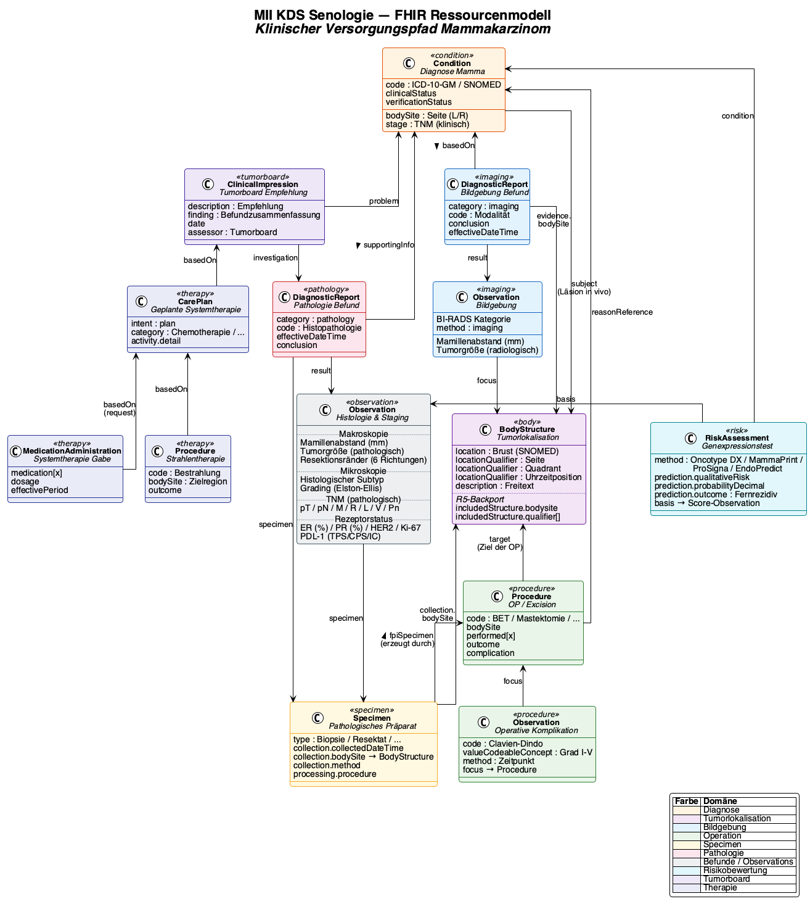

# Data Model - Kerndatensatz Senologie v0.10.0

* [**Table of Contents**](toc.md)
* **Data Model**

## Data Model

The Senology module is based on a logical model that structures the clinical data points of breast cancer care. This model is mapped to FHIR resources that are specified as profiles in this IG.

### Profile Inheritance

The Senology profiles inherit either from MII Core Dataset profiles (where oncological base structures are required) or directly from FHIR R4 base resources. The representation follows the clinical workflow: Information → Decision → Action.

#### Information (Medical History, Risk, Imaging, Pathology)

**Diagram will be added in a future version.**

#### Diagnosis & Workflow (Decision)

**Diagram will be added in a future version.**

#### Therapy (Action)

**Diagram will be added in a future version.**

### Reference Model

The profiles are linked to each other via FHIR references. The patient forms the central anchor point; the diagnosis is the clinical bracket for therapy and planning:

**Diagram will be added in a future version.**

### Logical Model

The [logical model](StructureDefinition-LogicalModelSenologie.md) (BIH_LM_Senologie) describes the clinical domain independently of the technical FHIR representation. It is oriented towards the documentation workflow of the breast centre (Brustzentrum) and the S3 guideline.

| | | |
| :--- | :--- | :--- |
| Diagnosis | Malignant and benign breast diseases, laterality, diagnostic confirmation, metastasis | [Condition](StructureDefinition-senologie-diagnose-maligne.md),[Condition (benign)](StructureDefinition-senologie-diagnose-benigne.md) |
| Presentation | Initial vs. follow-up visit with date | **planned: Encounter** |
| General Medical History | Quality of life (EQ-5D-5L) | **planned: Observation** |
| Gynaecological History (Gynäkologische Anamnese) | Menarche, menopause, pregnancies, HRT | [Observation](StructureDefinition-senologie-gynaekologische-anamnese.md) |
| Family History (Familienanamnese) | Breast/ovarian cancer in relatives | [FamilyMemberHistory](StructureDefinition-senologie-familienanamnese.md) |
| Clinical Examination | Palpation, skin changes, nipples, lymph nodes | [Observation](StructureDefinition-senologie-klinische-untersuchung.md) |
| Breast Imaging | Mammography, sonography, MRI, tomosynthesis with BI-RADS/ACR | [DiagnosticReport](StructureDefinition-senologie-bildgebung-befund.md),[Observation](StructureDefinition-senologie-bildgebung-observation.md) |
| Other Imaging | Staging imaging (bone scintigraphy, CT, PET-CT, etc.) | [DiagnosticReport](StructureDefinition-senologie-bildgebung-sonstige.md) |
| Pathology | Histology, receptor status (ER, PR, HER2, Ki-67), B3 lesions | [DiagnosticReport](StructureDefinition-senologie-pathologie-befund.md),[Specimen](StructureDefinition-senologie-pathologie-praeparat.md) |
| Tumour Localisation | Quadrant, clock-face position, distance from nipple | [BodyStructure](StructureDefinition-senologie-tumorlokalisation.md) |
| Gene Expression Test | Oncotype DX, MammaPrint, Prosigna, EndoPredict | [RiskAssessment](StructureDefinition-senologie-genexpressionstest.md),[Observation](StructureDefinition-senologie-genexpressions-score.md) |
| Surgery | Breast surgery with intent, sub-procedures, complications | [Procedure](StructureDefinition-senologie-operation.md) |
| Surgical Planning | Pre-operative planning (duration, marking, positioning) | [ServiceRequest](StructureDefinition-senologie-op-planung.md) |
| Surgical Complication | Clavien-Dindo classification | [Observation](StructureDefinition-senologie-operative-komplikation.md) |
| Systemic Therapy | Chemotherapy, hormone therapy, targeted therapy, immunotherapy | [Procedure](StructureDefinition-senologie-systemtherapie-procedure.md),[MedicationStatement](StructureDefinition-senologie-systemtherapie-medikation.md),[MedicationRequest](StructureDefinition-senologie-geplante-systemtherapie.md) |
| Radiotherapy | Irradiation with dose, boost, fractionation | [Procedure](StructureDefinition-senologie-strahlentherapie.md) |
| Tumour Board (Tumorkonferenz) | Interdisciplinary therapy recommendations | [CarePlan](StructureDefinition-senologie-tumorboard-empfehlung.md) |
| Implant | Breast implants (type, manufacturer, serial number) | [Device](StructureDefinition-senologie-implantat.md) |
| Medication | Concomitant medication | **planned: MedicationStatement** |
| Study Participation | Clinical trials | **planned: ResearchSubject** |

### Surgeries as Sub-procedures

Even though in clinical practice a surgical intervention is referred to as a single operation, accurate data representation requires the distinction into several sub-procedures:

* Identical or similar procedures on both sides (left, right) as separate procedures
* Intraoperative removal of lymph nodes in the case of lymph node metastasis as a separate procedure from the resection
* Reconstruction (autologous or implant-based) as a separate procedure from the resection

A parent `Procedure` can be defined, to which the sub-procedures refer via `Procedure.partOf`. Exception: Observations and complications that explicitly relate to a specific sub-procedure (e.g. implant revision).

### Terminologies

| | |
| :--- | :--- |
| SNOMED CT | Diagnoses, procedures, findings, medications |
| ICD-10-GM | Diagnosis coding (cancer registry, DRG) |
| LOINC | Laboratory values, imaging modalities |
| RadLex | Radiological finding categories (ACR, BI-RADS) |
| ATC | Drug classification |
| ASK | Drug substance catalogue (Arzneistoffkatalog) |
| OPS | Surgical and procedure key (Operationen- und Prozedurenschlüssel) |
| oBDS | Oncological core dataset (Onkologischer Basisdatensatz) |

[ConceptMaps](terminologie-medikation.md) are available for the medication terminology, mapping SNOMED CT to ATC and ASK.

