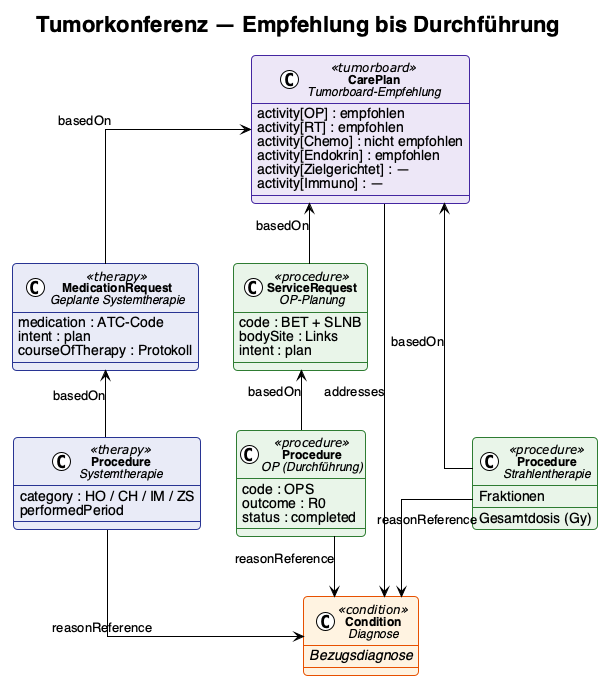

# Multidisciplinary Tumour Board - Kerndatensatz Senologie v0.10.0

* [**Table of Contents**](toc.md)
* [**Data Model**](datenmodell.md)
* **Multidisciplinary Tumour Board**

## Multidisciplinary Tumour Board

### Significance

The interdisciplinary tumour board (Tumorkonferenz) is the central decision-making body in breast cancer care. Senology, radiology, pathology, radiation oncology, medical oncology, and other relevant specialties convene to issue an individualised treatment recommendation based on all available findings. DKG certification requires the presentation of all patients with a malignant diagnosis — both pre-therapeutically (KB-2) and postoperatively (KB-1).

### Types

| | | |
| :--- | :--- | :--- |
| Pre-therapeutic | After diagnostic confirmation, before treatment initiation | Surgical strategy, neoadjuvant approach? |
| Postoperative | After definitive histology | Adjuvant therapy, follow-up strategy |
| Recurrence / Metastases | At progression | Change of treatment, palliative options |

### Recommendations as Individual Treatment Recommendations

The MII Oncology Module models tumour board recommendations as individual, standalone resources — not as a monolithic free-text entry. Each treatment modality is documented as a separate entry:

| | | |
| :--- | :--- | :--- |
| Surgical therapy | BCS left + SLNB | recommended / not recommended |
| Radiotherapy | Whole-breast 50 Gy + boost | recommended |
| Chemotherapy | Not recommended (Oncotype RS 18) | explicitly not recommended |
| Endocrine therapy | Aromatase inhibitor 5–10 years | recommended |
| Targeted therapy | — | not indicated |
| Immunotherapy | — | not indicated |

This granular modelling enables:

* Explicit documentation that a therapy was deliberately **not** recommended (e.g. "no chemotherapy")
* Subsequent reconciliation: was the recommendation actually implemented?
* Automated calculation of quality indicators (e.g. proportion of patients receiving a guideline-compliant recommendation)

### Implementation Control

Comparing the recommendation with the therapy actually administered is an important aspect of quality assurance. The data model supports this reconciliation by allowing the performed therapies (Procedure, MedicationRequest) to reference the tumour board recommendation.

### Conference Documentation

In addition to the substantive recommendations, the following contextual data are recorded:

* Date of the conference
* Participating disciplines
* Reason for presentation (initial diagnosis, postoperative, recurrence)
* Reference to the Condition (for bilateral tumours: which diagnosis?)

### Associated Resources

| | |
| :--- | :--- |
| Profile | [Senologie_Tumorboard_Empfehlung](StructureDefinition-senologie-tumorboard-empfehlung.md) |
| Questionnaire | [Tumorboard](Questionnaire-senologie-tumorboard.md) |
| Example | [Case 1 — Tumour Board](CarePlan-Fall1-Tumorboard.md) |

